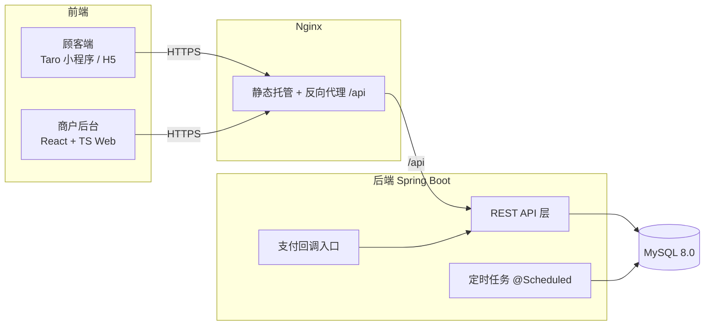
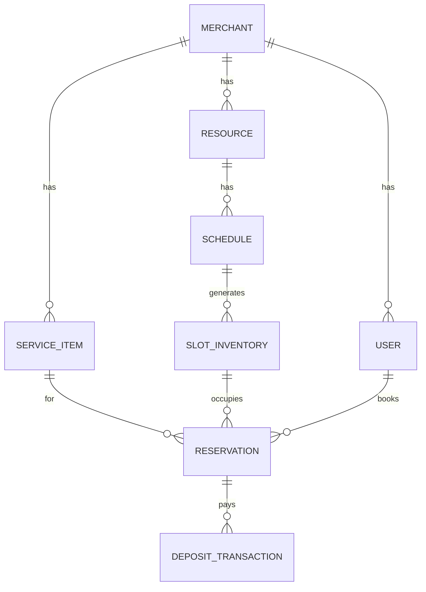

# 美容院轻量 SaaS 系统 · 项目技术文档（PTD）

> 文档状态：评审中
> 最后更新：2026-11-18
> 关联文档：README-PRD.md（需求文档）、README-BTD.md（后台服务技术文档）
> 适用读者：全栈开发、后续接手开发者、AI 编码助手

## 1. 概述

### 1.1 项目一句话

为单人/少人服务商户提供「预约 + 定金 + 排班」的轻量 SaaS 系统。

### 1.2 文档目标

锁定系统架构、数据模型、核心业务规则的技术实现方式、接口契约与部署方案，作为编码、联调、验收的依据。

### 1.3 与需求文档的边界

- 需求文档（PRD）定义：角色、核心闭环、业务规则、验收标准、范围外事项。
- 本文档定义：技术选型、数据模型、状态机实现、并发与幂等方案、API 契约、权限、部署与测试策略。
- 本文档不重复需求规则原文，只引用并说明「如何实现」。

## 2. 架构总览

### 2.1 系统上下文

- 顾客端（Taro 小程序/移动 H5）
- 商户后台（React Web，桌面优先）
- 后端 API（Spring Boot，统一 REST/JSON）
- 数据库（MySQL 8.0）
- 支付回调入口（演示环境用模拟支付，接口按真实回调契约设计）
- 定时任务（Spring @Scheduled：超时释放、提醒）

### 2.2 架构图



### 2.3 关键架构决策

| 决策 | 选择 | 理由 | 备选方案与放弃原因 |
|---|---|---|---|
| 前后端组织 | 独立后端 REST API（Spring Boot）+ 多前端 | 后端能力展示、前后端解耦、多端（小程序/H5/后台）复用 | Next.js API Routes（弃：与 Java 后端定位冲突） |
| 数据库 | MySQL 8.0 | 团队熟悉、事务 + 唯一约束防超卖、生态成熟 | PostgreSQL（弃：技术栈不匹配） |
| 时段库存 | 独立库存表 + 原子条件更新 | 避免聚合查询实时算余量、天然防超卖 | Redis 原子扣减（弃：引入额外组件，单机演示无需） |
| 认证 | Sa-Token | 轻量、注解式鉴权、适配 Spring Boot、不手写登录 | Supabase Auth / NextAuth（弃：非 Java 生态） |
| 数据库迁移 | Flyway | 版本化演进、避免手工改表漂移 | 手写 SQL（弃：易漂移） |

## 3. 技术栈

| 层 | 选型 | 版本 | 用途 | 备注 |
|---|---|---|---|---|
| 前端框架（顾客端） | Taro + React + TypeScript | Taro 4.x / React 19 | 小程序 + H5 一套代码 | 移动优先 |
| 前端框架（商户后台） | React + TypeScript | 19.x | 后台管理 | 桌面日历优先 |
| 样式 | Tailwind CSS | 4.x | 设计令牌落地 | |
| 后端 | Java + Spring Boot | Java 21 / Boot 4.1.x | 业务 API | |
| ORM | MyBatis-Plus | 3.5.9+ | CRUD 与复杂查询 | 基于 MyBatis，Mapper XML 支持复杂 SQL |
| 数据库 | MySQL | 8.0 | 主数据存储 | InnoDB，utf8mb4 |
| 认证 | Sa-Token | 1.45.0+ | 顾客与商户登录 | 注解式鉴权 |
| 数据库迁移 | Flyway | 10.x+ | 表结构版本管理 | |
| 定时任务 | Spring @Scheduled | Boot 内置 | 超时释放、提醒 | zone = Asia/Shanghai |
| 接口文档 | Apifox | — | API 契约 | |
| 部署 | Docker Compose + Nginx + 云服务器 | Docker CE 24.x+ / Nginx 1.27 | 前端静态 + 后端 API + MySQL | app 只 expose 不映射宿主机 |

## 4. 领域模型与数据库设计

### 4.1 实体清单

- merchant：商户（演示单租户但预留 merchant_id）
- user：账号（顾客/员工/管理员，含角色）
- service_item：服务项目
- resource：资源（技师 STAFF / 床位 ROOM）
- schedule：排班（可售窗口）
- slot_inventory：时段库存（独立成行，防超卖）
- reservation：预约单
- deposit_transaction：定金流水
- audit_log：关键操作审计

### 4.2 实体关系图



### 4.3 表结构定义（摘要）

> 完整 DDL 见 README-BTD.md 第 6 节。此处列关键约束与索引。

#### slot_inventory

| 字段 | 类型 | 约束 | 说明 |
|---|---|---|---|
| id | BIGINT | PK, 自增 | |
| merchant_id | BIGINT | FK, NOT NULL | 多租户预留 |
| resource_id | BIGINT | FK, NOT NULL | 资源 |
| slot_date | DATE | NOT NULL | 日期 |
| start_time | TIME | NOT NULL | 开始 |
| end_time | TIME | NOT NULL | 结束 |
| total | INT | NOT NULL, >=0 | 总容量 |
| used | INT | NOT NULL, >=0 | 已占用 |
| version | INT | NOT NULL DEFAULT 0 | 乐观锁 |
| status | TINYINT | NOT NULL DEFAULT 1 | 1 可售 / 0 锁定 |
| — | UNIQUE(resource_id, slot_date, start_time) | | 防重复建槽 |

其余表关键点：

- merchant / user / service_item / resource：常规业务表，merchant_id 建索引。
- reservation：唯一业务号 reservation_no，状态字段 status（见 5.4），appointment_time 建索引，用于超时扫描。
- deposit_transaction：唯一 out_trade_no（幂等键），UNIQUE 约束防重复入账。
- audit_log：只追加，不更新。

### 4.4 数据迁移与种子数据

- 迁移工具：Flyway（V1__init.sql 起）。
- 种子数据：演示商户 1 个、服务项目 3 个、资源 2 个（技师 + 床位）、未来 7 天排班及生成的时段库存。
- 回滚策略：向前修复（新增迁移），不回退已执行迁移；演示环境可重建库。

## 5. 核心业务技术设计

### 5.1 时段库存并发扣减

- 方案：数据库原子条件更新，保证「不超卖」。

```sql
UPDATE slot_inventory
SET used = used + 1, version = version + 1
WHERE id = #{id} AND used < total;
```

- 受影响行数 = 0 表示库存已满或槽位不存在，回滚预约创建并返回「时段已满」。
- 释放库存同样原子：

```sql
UPDATE slot_inventory
SET used = used - 1, version = version + 1
WHERE id = #{id} AND used > 0;
```

- 事务边界：创建预约 + 预占库存 + 写定金流水在同一数据库事务内。

### 5.2 支付回调幂等

- 以平台交易号 out_trade_no 为唯一幂等键（UNIQUE）。
- 回调处理：
  1. 查询 deposit_transaction，若状态非 PENDING 则直接返回成功（幂等）。
  2. 原子更新流转状态：

```sql
UPDATE deposit_transaction
SET status = 'SUCCESS', paid_at = NOW()
WHERE out_trade_no = #{outTradeNo} AND status = 'PENDING';
```

  3. 受影响行数 = 1 才继续：确认预约单（PENDING_PAYMENT → CONFIRMED）+ 最终扣减库存；= 0 说明已处理过，直接返回。
- 退款同理，只有 SUCCESS → REFUNDED 才执行「退定金 + 释放库存」。

### 5.3 超时释放

- @Scheduled(cron = "0 */1 * * * *", zone = "Asia/Shanghai")，每分钟扫描。
- 扫描条件：reservation.status = 'PENDING_PAYMENT' AND created_at < NOW() - 2h。
- 逐单处理：置为 EXPIRED + 释放库存（原子，见 5.1）。
- 处理加「预约单号」级状态条件，避免与支付回调并发竞争（状态条件更新天然互斥）。

### 5.4 预约单状态机

```
PENDING_PAYMENT --支付成功--> CONFIRMED --核销--> COMPLETED
PENDING_PAYMENT --超时/主动取消--> EXPIRED / CANCELLED
CONFIRMED --顾客取消(>=24h)/商户取消--> REFUNDING --> REFUNDED
```

- 所有状态流转用「当前状态作为 WHERE 条件」的原子更新，禁止先读后写。

### 5.5 定金流水状态机

```
PENDING --> SUCCESS --> REFUNDED
PENDING --> FAILED / EXPIRED
```

- 金额字段统一为「分」的 BIGINT。

### 5.6 排班与库存生成

- 商户保存 schedule（resource + date + start + end + capacity + slotMinutes），保存时同步生成 slot_inventory。
- 按固定步长 slotMinutes（默认 60，范围 5-480）拆分窗口，窗口时长必须是步长的整数倍；INSERT ... ON DUPLICATE KEY UPDATE 保证幂等，重复保存不重置 used。
- 同一资源同一天的排班时间窗口不可重叠；批量排班按星期（1=周一…7=周日）过滤，冲突日期跳过并返回原因。
- 已产生预约占用（used>0）或存在预约历史的排班：禁止改日期/时间/步长，禁止删除，只允许调整容量（不低于已占用）和状态；容量与状态变更同步刷新窗口内库存。
- 批量删除排班时逐条处理，有占用/预约历史的排班跳过并返回原因，其余正常删除。
- 排班 status=1→0 时窗口内时段全部锁定，0→1 时全部释放（会覆盖手工锁定）。
- 单个时段可手工锁定/释放（status=0/1）；释放前要求所属排班有效。
- 日历接口按天汇总排班数、时段数、总容量、已占用、可售、锁定数，无排班日期也返回。

## 6. API 契约（概览）

> 完整路径、请求/响应示例见 README-BTD.md 第 7 节。

- 统一前缀：/api/v1，统一响应结构 { code, message, data }。
- 顾客端：登录、服务列表、可售时段、创建预约、模拟支付、支付回调、预约、取消。
- 商户端：登录、服务/资源/排班 CRUD、日历、锁定/释放、预约列表、核销。

## 7. 权限与鉴权

- Sa-Token 登录态：顾客端与商户端分离登录。
- 角色：CUSTOMER / STAFF / ADMIN，通过注解 @SaCheckRole 控制。
- 数据隔离：所有查询携带 merchant_id，服务层强制拼接，防越权。

## 8. 部署方案

- 三容器：Nginx（前端 + 反代 /api）、app（Spring Boot）、MySQL。
- Nginx 托管前端静态资源，/api 反向代理到 app:8080。
- app 只对 Nginx 暴露，不映射宿主机端口。
- 配置通过环境变量注入（数据库连接、密钥、支付模拟开关）。

## 9. 测试策略

- 单元测试：Service 层状态机与业务规则。
- 集成测试：库存并发扣减（并发 10 单抢 1 库存）、支付回调幂等（重复推送）、超时释放。
- 接口测试：Apifox 契约测试。
- 验收：以 PRD 第 8 节验收标准为准。
